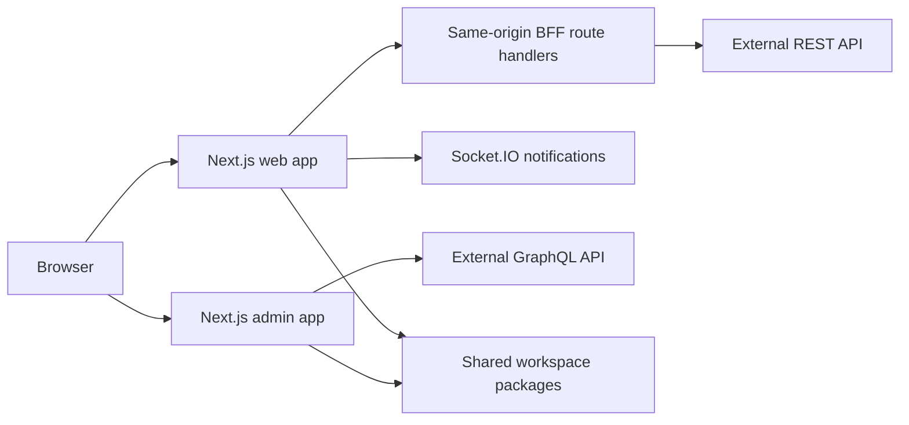

# Social Network Platform

> A production-oriented social network frontend built by a six-person team during an internship program. The project combines a multilingual user application, a separate administration console, shared workspace packages, a Backend-for-Frontend layer, real-time notifications, and AI-assisted post translation.

[](https://nextjs.org/)
[](https://react.dev/)
[](https://www.typescriptlang.org/)
[](#project-status)

This repository is a security-sanitized portfolio edition of the original team project. It preserves the authors, timestamps, commit messages, and merge history while excluding secrets, generated output, and private deployment configuration.

## At a glance

|                      |                                                                              |
| -------------------- | ---------------------------------------------------------------------------- |
| Applications         | User-facing web app and a separate admin app                                 |
| Architecture         | Next.js App Router, BFF route handlers, layered feature architecture         |
| Product scope        | Authentication, profiles, posts, media, notifications, payments, moderation  |
| Internationalization | English, Russian, French, Spanish, Italian, and Hebrew with RTL support      |
| Data layer           | TanStack Query, Zustand, Apollo Client, GraphQL, REST                        |
| Repository           | npm workspaces with shared authentication, localization, and layout packages |
| Scale                | 370 TypeScript/TSX files, 80 Sass files, and 30 content dictionaries         |

## Product functionality

### Authentication and account security

- Email registration with verification and resend flow
- Email/password sign-in and sign-out
- Google and GitHub OAuth callbacks
- Password recovery and new-password flow
- Optional Google reCAPTCHA protection
- Current-user hydration for server and client rendering
- Active device sessions with individual and bulk termination
- Account-management settings

Authentication is routed through the Next.js BFF. The browser talks to same-origin route handlers, while server-side utilities forward requests to the backend and manage access-token cookies. This keeps backend credentials and token handling out of feature components.

### Profiles and social content

- Public and authenticated profile pages
- Editable personal information and location fields
- Avatar upload with interactive crop, zoom, and positioning
- Public post feed and per-user post collections
- Post viewer with paginated navigation
- Create, edit, and delete operations
- Multi-step post creation: upload, crop, filters, description, and publishing
- Multiple images, location suggestions, and recoverable local draft state
- Responsive reusable UI primitives for forms, modals, tabs, pagination, and media controls

### AI-assisted translation

Users can request an on-demand translation of a post into the active interface language and switch between the translated and original versions. The feature includes:

- language-aware request parameters;
- loading, retry, unavailable, and unchanged-text states;
- TanStack Query caching to avoid repeated translation calls;
- a BFF endpoint that isolates the backend translation service from the browser.

The repository contains the frontend integration and interaction logic. The language model or translation provider is owned by the external backend and is not included here.

### Real-time notifications

- Authenticated Socket.IO connection using a short-lived socket token
- Infinite notification history loading
- Mark-as-read behavior and unread state
- Polling fallback when the socket transport is unavailable
- Cross-tab synchronization through `BroadcastChannel`
- Connection cleanup and reconnect error handling

### Payments and subscriptions

The profile settings area displays paginated payment history, subscription periods, providers, prices, and status mappings. Stripe and PayPal values returned by the backend are normalized for presentation; payment processing itself belongs to the external API.

### Administration console

The admin workspace has its own application shell, authentication flow, GraphQL client, and route tree. The implemented user-management area supports:

- user search and status filtering;
- sortable columns and URL-backed query state;
- configurable pagination;
- user details navigation;
- ban, unban, and delete actions with confirmation dialogs.

Routes for statistics, posts, payments, and detailed user views remain scaffolded from the original roadmap. They are intentionally not presented as completed modules.

## Architecture



```text
.
├── web/
│   ├── app/                 Next.js routes and BFF endpoints
│   └── src/
│       ├── app/             Providers and application composition
│       ├── pages/           Route-level screens
│       ├── widgets/         Composite interface blocks
│       ├── features/        User interactions and business flows
│       ├── entities/        Domain models, APIs, and entity UI
│       └── shared/          Infrastructure, utilities, and UI kit
├── admin/
│   └── src/
│       ├── app/             Admin route tree
│       ├── screens/         Admin screens
│       ├── features/        Authentication and moderation actions
│       ├── entities/        Admin domain models
│       └── shared/          GraphQL, utilities, and reusable UI
└── packages/
    ├── auth-core/           Shared authentication API and hooks
    ├── auth-ui/             Reusable authentication screens and forms
    ├── i18n-ui/             Locale-aware controls
    └── layout-ui/           Shared application shells
```

The source follows a Feature-Sliced-inspired dependency direction:

```text
app → pages/screens → widgets → features → entities → shared
```

ESLint boundary rules enforce these imports. Domain API code stays near its entity, business interactions live in features, and route files remain thin composition points.

## Important implementation decisions

### Backend-for-Frontend

More than 30 route handlers cover authentication, sessions, profiles, posts, uploads, notifications, payments, and translation. Shared server utilities provide consistent request forwarding, cookie propagation, error normalization, and response handling.

### Server and client data

- Server components perform initial public-profile and feed requests where appropriate.
- TanStack Query manages asynchronous client state, caching, pagination, and mutations.
- Zustand stores transient multi-step post creation state.
- Apollo Client is isolated to the admin GraphQL integration.

### Internationalization

Intlayer dictionaries are colocated with their components instead of being kept in one global translation file. Locale-prefixed routes are generated for six languages, and Hebrew layouts support right-to-left rendering.

### Styling and quality controls

- Sass Modules and shared design tokens
- Typed reusable controls and SVG sprite assets
- ESLint architecture boundaries
- Stylelint and Prettier formatting
- Husky and lint-staged pre-commit checks
- Independent production builds for both applications

## Technology stack

| Area               | Technology                                           |
| ------------------ | ---------------------------------------------------- |
| Framework          | Next.js 16, React 19, TypeScript 5.9                 |
| Server integration | App Router route handlers, REST BFF, secure cookies  |
| Client data        | TanStack Query, Apollo Client, GraphQL               |
| Local state        | Zustand, React Hook Form                             |
| Real time          | Socket.IO client, BroadcastChannel, polling fallback |
| Localization       | Intlayer, locale-prefixed routes, RTL support        |
| Styling            | Sass Modules, design tokens, SVG sprite system       |
| Tooling            | npm workspaces, ESLint, Stylelint, Prettier, Husky   |

## Running locally

### Requirements

- Node.js 20 or newer
- npm 10 or newer
- A compatible backend exposing the REST and GraphQL contracts used by the applications

Install the monorepo and create local environment files:

```bash
npm ci
cp web/.env.example web/.env.local
cp admin/.env.example admin/.env.local
```

Start the user application:

```bash
npm run dev
```

Start the admin application on port `3001` in a second terminal:

```bash
npm run dev:admin
```

### Environment variables

| Variable                         | Used by       | Purpose                                               |
| -------------------------------- | ------------- | ----------------------------------------------------- |
| `API_URL`                        | Web server    | Private backend base URL used by server-side requests |
| `NEXT_PUBLIC_API_URL`            | Web and admin | Public backend base URL                               |
| `NEXT_PUBLIC_GOOGLE_CLIENT_ID`   | Web           | Google OAuth client identifier                        |
| `NEXT_PUBLIC_RECAPTCHA_SITE_KEY` | Web           | Optional reCAPTCHA site key                           |

The example files contain placeholders only. Never commit real tokens, credentials, or environment values.

## Available commands

| Command               | Purpose                                  |
| --------------------- | ---------------------------------------- |
| `npm run dev`         | Start the user application               |
| `npm run dev:admin`   | Start the admin application on port 3001 |
| `npm run build`       | Build the user application               |
| `npm run build:admin` | Build the admin application              |
| `npm run lint`        | Lint the user workspace                  |
| `npm run lint:admin`  | Lint the admin workspace                 |
| `npm run stylelint`   | Validate Sass styles                     |

## Team and attribution

This is a collaborative project with clearly documented ownership. In the original product history, **Ilya Prihach was the principal contributor with 296 commits (52.8%)**, while **Artem Bedash was the second-largest contributor with 111 commits (19.8%)**. Together they authored 72.5% of the product commits and led the broadest architectural and feature tracks.

See [CONTRIBUTORS.md](CONTRIBUTORS.md) for the complete contribution breakdown, methodology, and each team member's main areas of work, or inspect the history locally:

```bash
git shortlog -sne HEAD
```

The portfolio preparation only removed generated files, environment configuration, personal email addresses, and private infrastructure artifacts. Product commits were not squashed into a single re-publication commit.

## Project status

The original internship project is no longer under active team development. This repository is maintained as an archived technical case study, so several roadmap screens are present as scaffolding and the applications require the original backend contract for full end-to-end operation.

No open-source license is granted at this time. The source is publicly available for portfolio review; copyright remains with the respective contributors.
