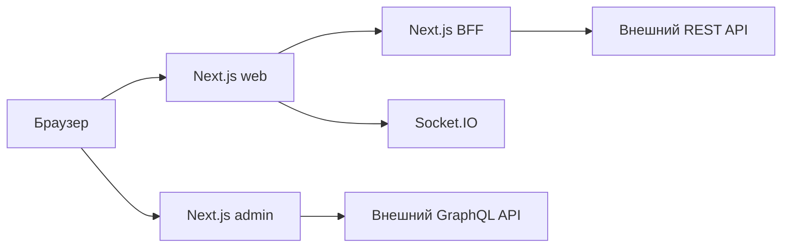

# Текущая архитектура

Снимок по исходному коду, без подтверждения запуском. Целевая архитектура собственного бэкенда ещё обсуждается.

`web/app/api` содержит BFF-маршруты для авторизации, профилей, постов, уведомлений и платежей. Подробности и ограничения: [BFF.md](../BFF.md). Админка содержит GraphQL-клиент и операции управления пользователями. Маршрут перевода постов реализован в Next.js и обращается к внешним провайдерам.

Целевые границы модулей, база, стек, протокол админки и подход к сессиям пока не выбраны. Выводы из анализа и возможные риски должны быть проверены до эксплуатации.
